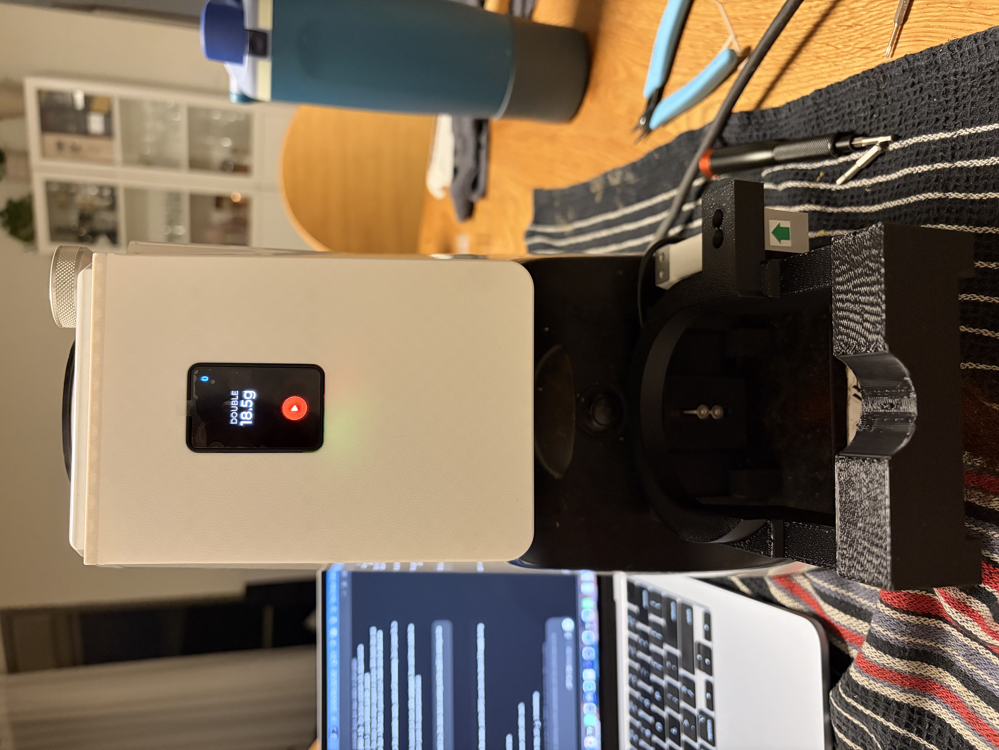

# Owner’s parts list

These are the shopping links supplied by the owner for this Atom65 conversion. Select the variant matching the specifications below; the links alone do not identify the selected size or board revision.

| Quantity | Part | Owner’s shopping link | Selection for this build |
|---:|---|---|---|
| 1 | ESP32 + display | [AliExpress](https://s.click.aliexpress.com/e/_c3ThBK6n) | Waveshare ESP32-S3-Touch-AMOLED-1.64 **V1.1**, 16 MB flash / 8 MB PSRAM |
| 4 | M3 × 10 screws | [AliExpress](https://s.click.aliexpress.com/e/_c3USKg07) | Socket-head; load-cell mounting |
| 2 | M3 × 18 screws | [AliExpress](https://s.click.aliexpress.com/e/_c4sP1HOx) | Socket-head; fixed adapter to the grinder’s metal bracket |
| 1 | HX711 | [AliExpress](https://a.aliexpress.com/_c3sbwv51) | Load-cell amplifier module; check dimensions against the panel holder |
| 1 | Capacitor | [AliExpress](https://a.aliexpress.com/_c3mTuf0n) | **1000 µF, at least 10 V**; holder sized for approximately Ø10.2 × 16.5 mm body |
| 1 | 1 kg load cell | [AliExpress](https://s.click.aliexpress.com/e/_c4KThdTd) | T70 geometry: nominal 70 × 22 × 15 mm; verify its drawing and wire certificate |
| As needed | DuPont kit | [AliExpress](https://s.click.aliexpress.com/e/_c3otVIoL) | Optional if you already have suitable connectors and wire |

Also allow for **four nominal M2 × 5 display screws** (confirm engagement on the actual module), **two reused original panel screws**, insulation and strain relief. The [assembly guide](../../3d_files/atom65/README.md#hardware-and-fasteners) explains all screw positions and the printable parts. The shopping links are the owner’s supplied references; listing contents, current availability and variant selections have not been independently checked.

## Owner’s assembled conversion

Owner-supplied photograph. Private photo metadata has been removed while retaining orientation. This shows the assembled conversion; it does not independently confirm every later CAD refinement.

Continue with the [wiring diagram and board photos](WIRING.md), [firmware installation](FIRMWARE.md) and [per-profile Decaid setup](DECAID.md).
