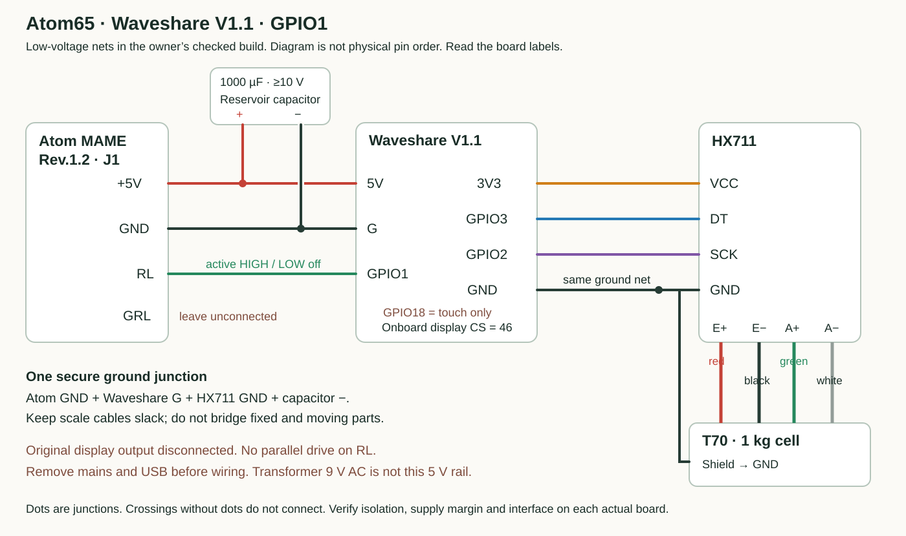
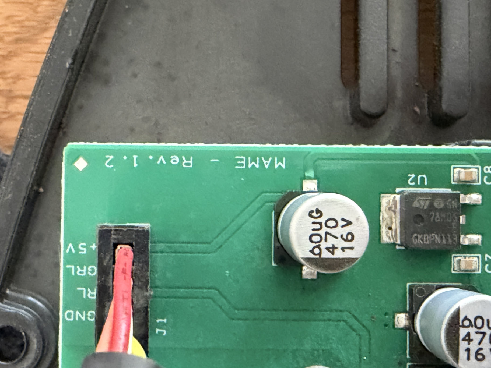
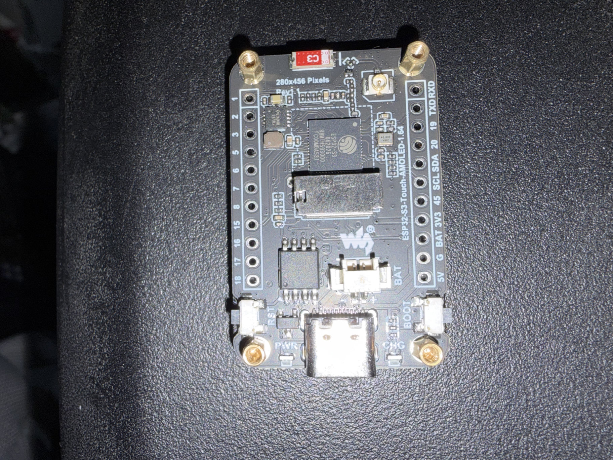

# Atom65 V1.1 wiring

This records the **low-voltage connections in the owner’s working build**: Atom Speciality 65, 220 V, purchased in 2022; MAME Rev.1.2 power/control board; Waveshare V1.1. Match the printed labels and board revision, not wire colours or an assumed connector orientation.

The grinder contains mains voltage. Internal identification/isolation and supply checks require a qualified technician. Do the wiring with mains and USB disconnected and stored energy discharged. The transformer’s **9 V AC** secondary is not the **+5 V DC** controller input. Do not connect USB and the Atom supply together in this build.

[Owner’s parts list and shopping links](PARTS.md).

## Connection map

The map shows nets, not the physical order of header pins. Make a secure insulated ground junction; the ground fan-out does not need several wires forced through one ESP32 solder hole.

| From | To | Notes |
|---|---|---|
| Atom J1 **+5V** | Waveshare **5V** | Verified controller DC rail; never 3V3, BAT, the AC transformer or motor terminals |
| Atom J1 **GND** | Common ground junction | Join Waveshare **G**, HX711 GND and capacitor negative |
| Waveshare **3V3** | HX711 VCC | HX711 logic stays at the ESP32’s 3.3 V level |
| Waveshare **GPIO3** | HX711 DT / DOUT | Scale data |
| Waveshare **GPIO2** | HX711 SCK / CLK | Scale clock |
| Waveshare **GPIO1** | Atom J1 **RL** | Active-high control in this checked build; LOW/off at boot. The original factory controller output must not drive RL in parallel |
| Atom J1 **GRL** | Unconnected | Its function was not established in this build |
| Capacitor **+** | Waveshare **5V** net | 1000 µF, rated at least 10 V, mounted close to the ESP32 |
| Capacitor **−** | Common **GND** net | Confirm the negative stripe/marking; do not rely only on leg length after trimming |
| T70 red / black | HX711 E+ / E− | This cell’s certificate; verify your own cell |
| T70 green / white | HX711 A+ / A− | Shield to GND; B+/B− unused |

**GPIO18 is reserved for touch on V1.1.** Leave an old GPIO18 motor lead disconnected and insulated. Do not connect it to RL. LCD CS is GPIO46 in this firmware; it is an onboard display connection, not an extra harness wire. [Waveshare revision documentation](https://docs.waveshare.com/ESP32-S3-Touch-AMOLED-1.64).

## Identify the actual board pads

### Atom MAME Rev.1.2 / J1

The silkscreen reads **GND / RL / GRL / +5V** in connector order. In this photograph the labelled row runs across the top of J1. Read the text on the actual board: a flipped or rotated harness reverses a visual left/right description. The original Atom display is replaced and disconnected in the finished conversion.

### Waveshare V1.1 rear header

In this view, with USB at the left, the **bottom row starts 5V, G, BAT, 3V3**. Leave BAT alone. The **upper row ends … 5, 3, 2, 1 at the right**: use 3/2 for HX711 and 1 for RL. The upper-left 18 pin is the touch interrupt and is not the motor output. Solder to the printed pad identifiers, with insulated strain-relieved leads. Photo pixels are unchanged; GPS/other private metadata were removed and orientation retained.

## What is measured and what still needs checking

The owner reported about 5 V from J1 +5V to GND; stock RL was about 3 V while grinding and near 0 V stopped. RL traces through R7 (marked 1001, about 1 kΩ) toward the transistor driver, with an approximately 100 kΩ path to ground. The assembled GPIO1 → RL connection subsequently ran/stopped the motor in the local one-second test and a normal weighed grind.

These observations support this particular active-high interface. They do not establish isolation, safe available 5 V current, RL input thresholds, or suitability of another Atom board revision. Check those before copying a direct GPIO connection. The reservoir capacitor buffers brief dips; it does not add regulation or isolation and cannot make an undersized supply adequate.

## Commission in stages

1. **USB scale only:** Atom harness disconnected. Confirm display, touch, HX711, known-mass calibration and return to zero.
2. **Unpowered harness inspection:** remove USB and mains, then verify 5V/GND polarity, capacitor polarity, insulated joints, slack scale wiring and separation of fixed/moving parts. Check for shorts before power.
3. **Atom power only:** reconnect the checked harness and power the grinder normally. Confirm the controller and scale stay stable; inspect the controller supply under load with appropriate equipment.
4. **Local motor test:** clear the grinder, fit guards and keep hands away. Use Menu → Motor Test and verify that it stops. Verify power-up/reset and stale-scale behavior on the actual unit before normal use.
5. **Weighed dose:** check the selected target, start locally and compare the settled weight. Tune delivery/retention for your grinder rather than assuming another grinder’s settings.
6. **Decaid:** follow [the per-profile setup](DECAID.md). A received dose selects CUSTOM; it does not start the motor.

Do not modify the mains motor circuit or original protective devices using this guide. The original motor capacitor is separate from the added controller reservoir capacitor.
